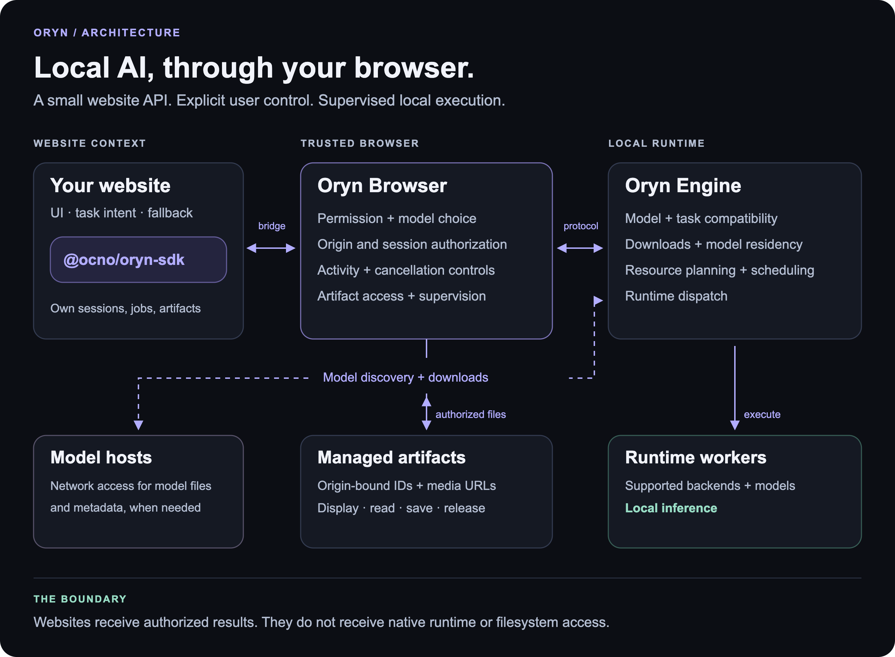
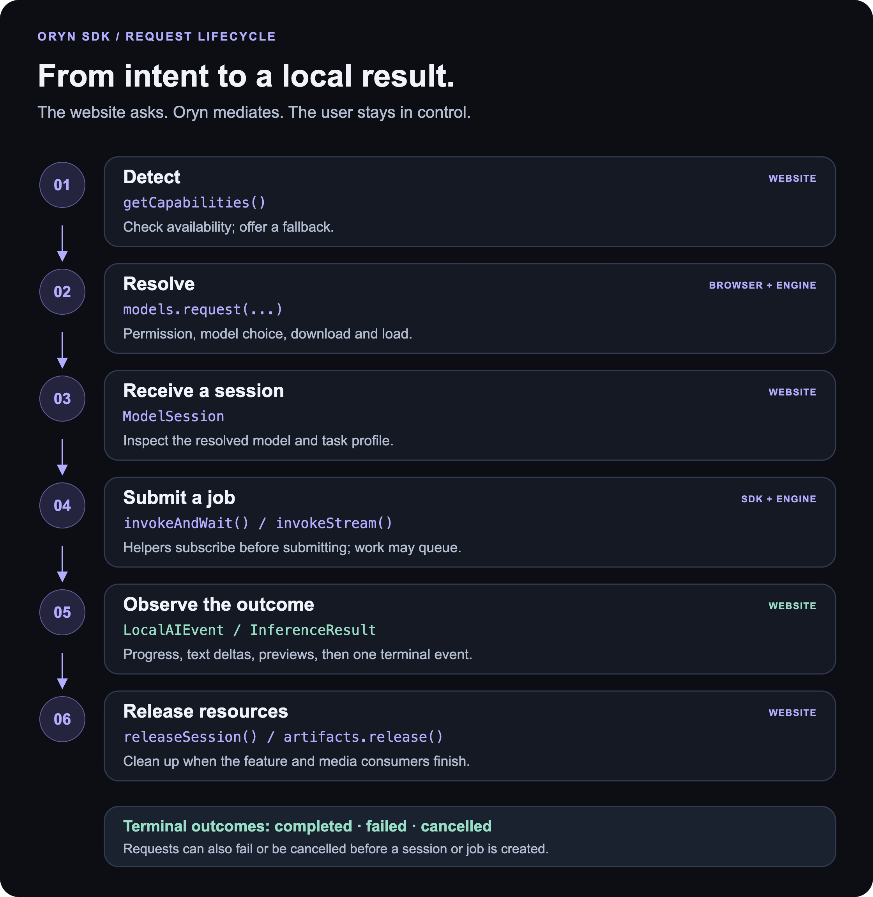
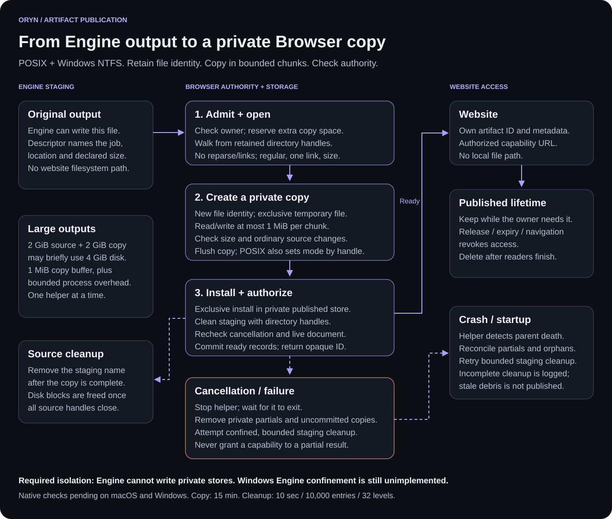

# Oryn architecture

[Overview](../README.md) · [SDK guide](../projects/oryn-sdk/README.md) · [API reference](../projects/oryn-sdk/docs/api-reference.md)

Oryn connects ordinary websites to local model execution through a browser-owned capability boundary. The website describes what it needs; trusted Browser services mediate access; the Engine determines how the work can execute.

## The component boundaries

| Component | Owns | Website access |
| --- | --- | --- |
| Website + SDK | Application UI, task intent, fallback behavior, result presentation | The site's own sessions, jobs, and artifacts |
| Oryn Browser | Trusted permission/model-choice UI, origin authorization, session ownership, artifact access, activity controls, Engine supervision | A constrained injected bridge |
| Oryn Protocol | Versioned Browser–Engine messages and validated task contracts | SDK-facing types expose the relevant task requirements and profiles |
| Oryn Engine | Model inspection, executability, downloads, memory/resource planning, physical model state, residency, and job scheduling | No direct website connection |
| Runtime workers | Model loading and inference through supported runtime backends | No website process or filesystem access |

Browser enforces who is allowed to request work. Engine decides whether a model can perform that work with the available runtime and resources. The Browser owns trusted user interaction; the Engine remains authoritative about technical executability.

Runtime selection is implementation detail. The SDK never asks a website to choose a Python environment, native executable, GPU device, or runtime-pack path. Supported backends include MLX, llama.cpp, Transformers, Diffusers, and ONNX-based execution paths; the actual route depends on the model and task.

## From a user action to a result

1. **Detect.** `getCapabilities()` reports runtime availability and feature flags. Importing the SDK and creating a client do not ask for permission or start inference.
2. **Resolve.** `models.request()` declares a role, model intent, and task requirements. Browser can ask for permission or model choice; Engine checks compatibility and resource feasibility. A download or model load may be necessary.
3. **Attach.** The caller receives a `ModelSession`, including the resolved model and, when available, an effective `taskProfile`. The session identifies an authorized relationship to a task/model; it is not a filesystem handle.
4. **Submit.** `invoke()` returns a job reference. A job may wait for the shared generation lane or for model/resource preparation.
5. **Observe.** Events carry state, queue position, progress, incremental output, previews, and one terminal outcome. SDK helpers arrange subscription before submission and filter events to the new job.
6. **Consume and release.** Results are structured data, artifact references, or a combination. Keep artifacts while the UI needs them; release them and the model session when finished.

Requests can fail or be cancelled before completion. The website must handle those paths without treating a partial stream as a successful final result.

## Model intent and effective capabilities

A preferred model is developer intent, not a promise that it will run. A capability-only request can ask Oryn to find an executable match; an explicit request can name a Hugging Face model, approved alternatives, and a substitution policy. Newer browsers also understand source-checkpoint, preferred-variant, and exact-artifact selection.

The returned `resolution` reports the selected revision, substitution, compatibility, and trust. These are distinct:

- **Compatibility:** does this model satisfy the requested task and constraints?
- **Executability:** can the available Engine/runtime actually run it?
- **Trust:** has the exact model revision been verified by Oryn or explicitly approved by the user as unverified?

User approval cannot make an unsupported runtime, unsafe model format, or impossible resource plan executable. Developer-declared `certifiedModels` are also separate from Oryn's exact-revision trust decision.

When task profiles are available, request a versioned contract and required features. The returned `taskProfile` describes effective features, parameter handling, defaults, limits, and streaming channels. A schema or advertised task alone is not proof that every checkpoint has been executed successfully.

## Two paths for data

**Control and structured data** travel through the SDK bridge and versioned Browser–Engine messages: model requests, job IDs, progress, small JSON inputs, and structured results.

**Binary media** use artifacts. The website creates an artifact from a `File` or `Blob` and passes its opaque ID in the task input. Browser authorizes the reference before the work can use it. Outputs are copied in bounded chunks into new Browser-owned files and exposed through authorized metadata and URLs. The handoff can temporarily require space for both the Engine source and the Browser copy; it does not load the whole output into Browser memory.

| Operation | What happens |
| --- | --- |
| `artifacts.create(file)` | Copies website-provided bytes into managed artifact storage |
| `artifacts.getUrl(id)` | Returns an opaque URL for media display or fetching |
| `artifacts.readBlob(id)` | Reads the complete output into renderer memory |
| `artifacts.saveAs(id)` | Opens trusted browser UI to save an output |
| Website `fetch()` upload | Explicitly sends bytes to the site's chosen server |
| `artifacts.release(id)` | Releases the website's artifact capability |

Artifact IDs and URLs are scoped capabilities, not disk paths. They should not be persisted as permanent links or shared across origins. Releasing a model session is separate from releasing artifacts.

## Output publication and cleanup

Browser retains trusted directory handles, securely opens an Engine output, and
copies its bytes into private storage before returning an artifact capability.
The staging source is then cleaned up. The published copy remains until its
lifetime ends and active readers release it. Cancellation and failures remove
partial private copies; bounded cleanup can leave debris for startup retry.
A 2 GiB output may briefly use about 4 GiB of disk space. Browser reserves the
additional copy space and streams with a 1 MiB buffer.

The [implementation and validation notes](artifact-publication.md) describe the
POSIX and Windows NTFS backends, disk limits, lifecycle and remaining native checks.
Windows Engine process confinement remains separate unfinished work; the copy
backend does not by itself isolate private storage from an unrestricted Engine.

## Scheduling and lifetime

The current generation lane is shared across origins and runs one generation job at a time. Read `capabilities.scheduler` when displaying scheduling information rather than assuming a fixed concurrency forever. Queue events expose the caller's job position without revealing another website's prompt or identity.

A website can submit multiple jobs. Switching tabs does not itself cancel them; the user can inspect or cancel work through trusted Browser activity UI. A website can cancel its own job. Cancellation may take effect at the next safe runtime point.

Treat sessions, jobs, and artifact URLs as temporary. Do not assume they survive browser restart or navigation. Reusing a live session avoids resolving a model for every message; release it when the feature is disposed.

## Network and process isolation

Model discovery and downloads may contact model hosts. In packaged macOS operation, Browser supervises a sandboxed Engine and launches runtime workers with a separate filesystem boundary and no-network policy. Packaging checks verify these resources. A source development run is not the same qualification as a packaged build.

The website still has its ordinary web-network capabilities. Once the user gives it a file or it obtains an authorized output, it can send those bytes through its own application code. Local inference is therefore a property of the execution path, not a blanket guarantee about every site's behavior.

The website bridge does not expose Electron APIs, Python execution, shell commands, precise hardware inventory, global model deletion, or other origins' activity.

## Read the implementation

These entry points are product source, not additional services the website calls:

- [SDK client and helpers](../projects/oryn-sdk/src/client.ts)
- [Website API types](../projects/oryn-sdk/src/types.ts)
- [Shared task inputs and outputs](../projects/oryn-sdk/src/shared-tasks.ts)
- [Browser implementation](../projects/oryn-browser/apps/browser/src/main/)
- [Engine implementation](../projects/oryn-engine/src/oryn_engine/)
- [Protocol implementation](../projects/oryn-protocol/)

The diagram SVGs are editable source assets. They illustrate the current website API and runtime boundaries, not a public service deployment or a guarantee of model availability.

The SVG diagrams are the editable source assets; update the PNG previews after editing them.
Run `pnpm docs:check` from the repository root to check local documentation links
and compile the TypeScript examples against the SDK.
