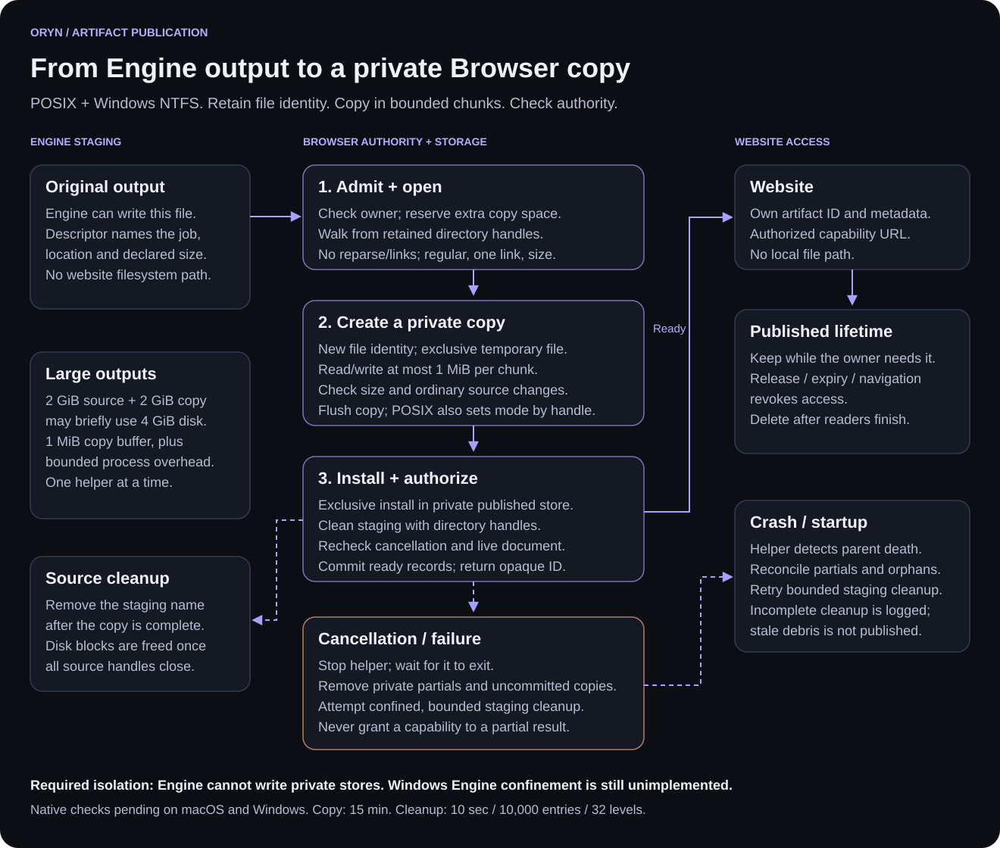

# Output artifact publication

[Architecture](architecture.md) · [Implementation and verification](#source-and-verification)

The Browser publishes a **new private copy** of each Engine output. Securely opened
handles bind validation and copying to the same source file; changing permissions
or renaming an Engine-owned path would not provide that guarantee. A checksum
alone does not bind a later filesystem operation to the checked file.



## Boundary and implementation

An ordinary website receives artifact IDs and authorized URLs. It cannot choose
an output filesystem path. This boundary assumes an Engine able to manipulate
its own staging directory; it does not establish an initial Engine compromise.

1. Browser canonicalizes its trusted storage root once, before Engine startup,
   and retains open handles to staging, private temporary and published roots.
2. Browser validates job/document ownership and output metadata, converts the
   internal path to job-relative components, and reserves additional copy space.
3. A Browser-owned helper walks every source component using directory-relative,
   no-follow opens. It checks the opened leaf is regular, has one link, and has
   exactly the declared size. POSIX opens are also nonblocking.
4. The helper copies through that retained source handle into an exclusively
   created private file, reading at most 1 MiB per iteration. It enforces the
   declared byte count, rejects early EOF/growth and ordinary metadata changes,
   then checks the destination size and flushes the file. POSIX additionally
   applies mode `0400` through the destination handle.
5. The helper exclusively installs the new inode in private published storage.
   Both private stores must be on the same filesystem. Directory entries are
   flushed where supported. Browser never uses an `EXDEV` fallback that reopens
   an Engine pathname, and never moves or chmods the Engine inode.
6. Browser cleans staging through directory handles, rechecks cancellation and
   document authority, and commits ready records. Only then are IDs returned.
   A multi-output failure rolls back all uncommitted copies.

The POSIX helper is shipped as `build/helpers/artifact_io.py` and uses the existing
bundled Python runtime with `-I -S -B`. It imports only the standard library, uses
a fixed executable-search PATH, and does not inherit credentials or Python import
configuration. It receives three explicitly inherited directory handles. The
source-checkout default uses an installed `python3`; packaged Browser explicitly
selects its bundled interpreter and helper resource.

Missing primitives fail closed; there is no pathname-copy fallback. Packaged
macOS must enforce the Engine/worker
sandbox denial of writes to Browser-private temporary and published roots.
Same-user mode bits alone are insufficient. Unsandboxed source development does
not provide that isolation guarantee.

### Windows backend

`build/helpers/artifact_io_windows.py` implements the same copy protocol using
stdlib `ctypes` and Windows file APIs. Browser selects it on `win32`; packaging
includes both helpers. The Windows interpreter must have an absolute path: the
bundled interpreter in packaged builds, or a configured `ORYN_ENGINE_PYTHON` in a
source checkout. The child receives only `SystemRoot` and an empty `PATH`, with
`-I -S -B`; no credentials or Python search configuration are inherited.

Before Engine startup, a synchronous initialization helper opens the three roots
and duplicates non-inheritable native handles into Browser. Later helpers
duplicate these retained handles back, rather than reopening the roots by name.
Shutdown closes Browser's handles through a bounded helper; process exit also
reclaims them if that release fails. A helper watches a parent process handle and
exits on parent death. [Windows handle duplication](https://learn.microsoft.com/en-us/windows/win32/api/handleapi/nf-handleapi-duplicatehandle)
provides the process-to-process handle transfer.

Each source component is opened relative to its parent with `NtCreateFile` and
`FILE_OPEN_REPARSE_POINT`; the opened handle is checked before proceeding.
Directories remain open during traversal, without delete sharing. Reparse points,
non-disk/nonregular files, hard-linked sources, alternate data streams, traversal,
device names and ambiguous Windows filenames are rejected. Windows supports
these [directory-relative opens](https://learn.microsoft.com/en-us/windows/win32/api/winternl/nf-winternl-ntcreatefile).

The destination is created exclusively with no sharing, streamed in 1 MiB chunks,
checked and flushed. `SetFileInformationByHandle` renames that private copy into
the opened published bucket with replacement disabled. Cleanup enumerates opened
directories and deletes opened entries; a reparse point is deleted as an entry,
never traversed. See [handle-based rename](https://learn.microsoft.com/en-us/windows/win32/api/winbase/ns-winbase-file_rename_info).
Source cleanup can be deferred when another Windows handle disallows deletion.

This backend currently requires local fixed NTFS storage; network shares, other
filesystems and cross-volume installation fail closed. It uses inherited private
store access controls, not POSIX modes or a read-only attribute as a sandbox.
**Windows Engine/worker confinement is not implemented in this repository.** An
unrestricted same-user Engine can still access private stores directly. The new
copy backend therefore does not establish the complete compromised-Engine
isolation guarantee on Windows. Native Windows qualification and that separate
process-isolation work remain release requirements.

A retained source handle pins file identity, not an atomic snapshot of bytes
being edited concurrently. The Engine already chooses its output content. The
copy isolates published bytes from subsequent Engine writes; it does not certify
that generated media is benign or matches its claimed format. Existing Browser
MIME and metadata normalization still applies.

## Large outputs and disk capacity

| Resource | Behavior |
| --- | --- |
| Source plus copy | Both can coexist: a 2 GiB source may temporarily need about 4 GiB of disk |
| Copy buffer | 1 MiB chunks; total process memory includes interpreter and I/O overhead, but does not scale with file size |
| Helper concurrency | One helper operation per Browser artifact store at a time |
| Default managed-artifact budget | 20 GiB |
| Default pending temporary reservations | 10 GiB in aggregate |
| Default free-disk safety reserve | 1 GiB |
| Publication wall limit | 15 minutes; timeout kills the helper and rolls back private files |

Admission reserves the entire additional copy, including other pending
reservations. It conservatively counts outstanding reservations even when some
bytes have already been written. Other processes can consume disk after
admission; ENOSPC still fails cleanly. These checks do not impose a filesystem
quota on an already compromised Engine's independent writes.

Duplicating a file handle would reference the original inode and would not
provide this isolation. No reflink/clone optimization is implemented.

## Lifetime and failure handling

| Event | Cleanup |
| --- | --- |
| Successful final result | Remove the job staging tree after the private copy is complete; register the copy only after the final authority check |
| Successful preview | Remove only that preview's source files; retain the job's other staging files |
| Copy error, timeout or cancellation | Stop and wait for the helper; remove private partials/uncommitted objects; attempt confined staging cleanup |
| Navigation/document invalidation | Abort pending publication and revoke existing document-owned capabilities |
| Release or expiry | Revoke access; delete the published file once active readers/leases finish |
| Browser crash | Helper detects parent death and exits; next startup reconciles private partials, orphan copies and stale staging |
| Live Settings temporary cleanup | Remove private partials only when no Browser write/publication is pending; leave Engine staging to job cleanup/startup |

Removing a staging pathname does not reclaim its disk blocks until all open
handles close. A compromised Engine retaining a writer cannot alter the private
copy, but can delay release of its original file's blocks until the handle or
process closes.

Staging cleanup is bounded to 10,000 entries, 32 directory levels and 10 seconds
per operation. It never follows directory links. If cleanup cannot finish, it
logs an incomplete result and leaves unpublished debris for a later startup
retry. Such debris does not prevent normal Browser startup or gain a capability.
The reconciler reports `stagingCleanupComplete`; it does not claim a partial
cleanup removed every root.

## Source and verification

- [Browser helper](../projects/oryn-browser/apps/browser/build/helpers/artifact_io.py)
- [Windows helper](../projects/oryn-browser/apps/browser/build/helpers/artifact_io_windows.py)
- [Portable and native Windows helper tests](../projects/oryn-browser/apps/browser/build/helpers/test_artifact_io_windows.py)
- [Helper process and retained root handles](../projects/oryn-browser/apps/browser/src/main/artifact-manager/artifact-file-service.ts)
- [Storage and rollback](../projects/oryn-browser/apps/browser/src/main/artifact-manager/artifact-storage.ts)
- [Publication authority and lifetime](../projects/oryn-browser/apps/browser/src/main/artifact-manager/artifact-manager.ts)
- [Async event delivery and cancellation](../projects/oryn-browser/apps/browser/src/main/jobs/browser-job-registry.ts)
- [Publication regressions](../projects/oryn-browser/apps/browser/src/main/__tests__/artifact-publication.test.ts)

The regression suite uses small disposable fixtures, including a multi-chunk
copy, retained source writer, invalid links/file types, disk reservations,
multi-output rollback, cancellation and document invalidation. Artifact ownership, serving, lifetime and job-event tests cover publication and its callers.
No multi-gigabyte allocation or live user file is needed to check these invariants.

Linux POSIX tests establish the tested local behavior. A packaged macOS release
still needs verification of directory-relative APIs, isolated bundled-helper
startup, Engine/worker denial of private-store writes, cancellation and restart
cleanup under the shipped profiles.

The Windows test file contains portable policy/ABI tests and Windows-only native
tests for copying, hard links, collisions, invalid sizes, subprocess handle
transfer/lifetime, and reparse-point rejection/cleanup. Native cases are skipped
on Linux; the directory-symlink fixture additionally needs Windows Developer Mode
or symlink privilege. Run it with the bundled Python in a disposable Windows OS
sandbox with bounded network, filesystem, environment and resource access:

```text
<absolute-python.exe> -I -S -B build/helpers/test_artifact_io_windows.py -v
```

The Browser tests also exercise Windows helper selection, initialization failure,
environment filtering, handle-release requests and cancellation/draining with
process doubles. Those tests do not establish Win32 API or filesystem behavior.
