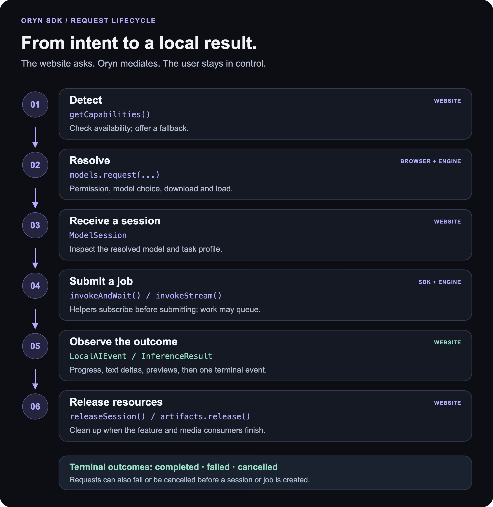

# Oryn SDK

**Local AI for ordinary websites.** `@ocno/oryn-sdk` is a TypeScript-first ESM client for Oryn Browser. Request a model, submit a job, and receive streaming text, structured data, or media artifacts through one framework-independent API.

**[Quickstart](#stream-your-first-response) · [API reference](docs/api-reference.md) · [Recipes](docs/recipes.md)**

- No runtime dependencies on React, Electron, Node.js, Python, or an inference engine.
- Safe to import and create during server-side rendering.
- Typed model requests, job events, artifacts, and task contracts.
- Browser-owned permission, model choice, and origin isolation.

> **Developer alpha · 0.1.0**
>
> LocalAI requires a compatible Oryn Browser. Installing this package alone does not provide model execution.

## Install

```bash
npm install @ocno/oryn-sdk
```

The package exports ESM and TypeScript declarations. Execute Local AI feature work in the browser, from a deliberate user action. Serve production integrations over HTTPS; use loopback origins for development.

## Stream your first response

This function requests a chat model, streams text into your callback, handles terminal failure/cancellation, and releases the session. Call it from your Send button and pass an `AbortController` signal from your Cancel button.

```ts
import {
  createLocalAIClient,
  invokeStream,
  LocalAIError,
} from "@ocno/oryn-sdk";

export async function streamReply(
  prompt: string,
  appendText: (text: string) => void,
  signal: AbortSignal,
): Promise<void> {
  const localAI = createLocalAIClient();
  const capabilities = await localAI.getCapabilities();
  if (!capabilities.runtimeAvailable) {
    throw new Error("Open this page in Oryn with Local AI available.");
  }

  const session = await localAI.models.request(
    {
      role: "chat",
      requirements: {
        task: "text-generation",
        inputModalities: ["text"],
        outputModalities: ["text"],
        capabilities: { chat: true, streaming: true },
      },
    },
    { signal, onProgress: (progress) => console.info(progress.stage) },
  );

  try {
    for await (const event of invokeStream(
      localAI,
      {
        sessionId: session.sessionId,
        input: { messages: [{ role: "user", content: prompt }] },
      },
      { signal },
    )) {
      if (event.event === "job.output.delta" && event.data.channel === "text") {
        appendText(String(event.data.delta));
      } else if (event.event === "job.failed") {
        throw new LocalAIError(event.data.error);
      } else if (event.event === "job.cancelled") {
        throw new LocalAIError({
          code: "REQUEST_ABORTED",
          message: "Generation was cancelled.",
        });
      }
    }
  } finally {
    await localAI.models.releaseSession(session.sessionId);
  }
}
```

A capability-only request lets Oryn resolve a matching model. It may require model choice, permission, or a download; it can fail if no executable match exists. To suggest a particular model, use the [model selection recipe](docs/recipes.md#choose-a-model).

`invokeStream()` yields **all** job events, including terminal failure and cancellation. It does not convert those terminal events into thrown errors. `invokeAndWait()` does that conversion for callers that want a final result. Both helpers subscribe before submitting the job.

## The request lifecycle



[View the full-size lifecycle diagram](docs/images/request-lifecycle.svg).

| Concept | Meaning |
| --- | --- |
| **Client** | A lightweight wrapper around Oryn's injected website bridge |
| **Model request** | Your task, preferred model or capability requirements, and substitution policy |
| **Session** | An origin-bound handle to the resolved model and its effective task capabilities |
| **Job** | One asynchronous invocation, with queue/progress/output and a terminal event |
| **Artifact** | An opaque capability for binary input or output |

A session can be reused across jobs. The quickstart releases it after one response for clarity; a chat app can keep one while the conversation UI is active. Release it when the feature is disposed.

## Detect Oryn and provide a fallback

```ts
import { createLocalAIClient } from "@ocno/oryn-sdk";

export async function canUseLocalAI(): Promise<boolean> {
  const localAI = createLocalAIClient();
  return (await localAI.getCapabilities()).runtimeAvailable;
}
```

Outside Oryn, `getCapabilities()` resolves with `runtimeAvailable: false`. Privileged operations reject with `LocalAIError` code `RUNTIME_NOT_AVAILABLE`. Importing and creating the client are SSR-safe; model requests and jobs belong in client-side code.

Build your own explanation, disable the local action, or offer a clearly disclosed fallback. You can optionally create the client with `{ showOrynBrowserAlert: true }` to show a website-owned Oryn explanation once per document outside Oryn. It is off by default and is not a trusted permission prompt.

## Pick the right invocation API

| API | Use it when | Completion behavior |
| --- | --- | --- |
| `invokeAndWait(client, request, options)` | You need the final structured/media result | Resolves on completion; rejects on job failure or cancellation |
| `invokeStream(client, request, options)` | You need incremental text, progress, or previews | Yields events through the terminal event; inspect its outcome |
| `client.invoke(request)` + `client.subscribe(listener)` | You manage your own job state | Returns a job reference; subscribe before invocation and filter by job ID |

Pass `signal` to model requests and helpers for cancellation. `client.cancel(jobId)` targets a known job directly. Breaking out of a stream only unsubscribes the helper; it does not cancel the underlying job. Read the [cancellation notes](docs/api-reference.md#cancellation-and-cleanup) before building a custom job manager.

## Work with files and results

Use `artifacts.create(fileOrBlob)` for binary input and put the returned ID in the task input. Results use one of three shapes:

| `result.kind` | Payload |
| --- | --- |
| `structured` | `result.value`: task-specific JSON |
| `artifact` | `result.artifact`: metadata for an image, audio file, video, or other output |
| `multi` | `result.outputs`: a list of result envelopes |

Display media with `artifacts.getUrl(id)`, read complete bytes with `artifacts.readBlob(id)`, or open a trusted save dialog with `artifacts.saveAs(id)`. Release artifacts after their final consumer is finished. An upload is a separate, explicit website action.

See [transcription](docs/recipes.md#transcribe-a-wav-file) and [media outputs](docs/recipes.md#display-save-and-upload-an-output) for complete examples. Artifact IDs and URLs do not expose local paths and should not be treated as permanent links.

## Handle expected failures

Use `LocalAIError.code`, not the English message, for application behavior. Common cases include:

| Code | Suggested UI |
| --- | --- |
| `RUNTIME_NOT_AVAILABLE`, `RUNTIME_STARTING` | Show availability state or a fallback |
| `USER_DENIED`, `PERMISSION_DENIED` | Respect the decision and leave the feature idle |
| `NO_EXECUTABLE_MODEL`, `MODEL_NOT_EXECUTABLE` | Explain the unmet model/task requirement |
| `MODEL_OUT_OF_MEMORY`, `RESOURCE_REQUIREMENTS_UNSATISFIABLE` | Offer a smaller compatible model or lower supported settings |
| `JOB_QUEUE_FULL` | Keep the input and let the user retry later |
| `REQUEST_ABORTED`, `JOB_CANCELLED` | Treat cancellation as an ordinary outcome |

Browser/Engine failures are sanitized at the bridge. Application code and some local validation or network operations can also throw ordinary JavaScript errors, so retain a general error path.

## Task profiles and compatibility

Check `capabilities.features.taskProfiles` before opting into versioned task requirements. A returned `session.taskProfile` describes effective features, parameter bounds/defaults, limits, and streaming channels. Requirements must not silently disappear on an older browser; if a feature is necessary for your app, explain that it is unavailable.

`SharedTaskInputs`, `SharedTaskOutputs`, and `validateSharedTaskInput` support additional typed tasks. Their presence describes data contracts, not availability of a model on a particular device. See the [typed-task recipe](docs/recipes.md#use-a-typed-task-contract).

The npm version and `localAI.sdkVersion` identify the SDK. `browserApiVersion` identifies the injected browser API; task contracts carry their own revisions. Check feature flags and effective profiles instead of inferring support from the SDK version alone. The current `0.1.0` API is a developer alpha and may evolve before a stable release.

## Develop the SDK

From this directory:

```bash
pnpm install --frozen-lockfile
pnpm typecheck
pnpm test
pnpm build
pnpm pack
```

The `dist` and `docs` directories, this README, and the MIT license are included in the package. Documentation examples are checked against the SDK types from the full workspace with `node scripts/check-public-docs.mjs`.

Read [CONTRIBUTING.md](CONTRIBUTING.md) for API change requirements and [SECURITY.md](SECURITY.md) for sensitive reports.

## License

Oryn SDK is licensed under the [MIT License](LICENSE).
